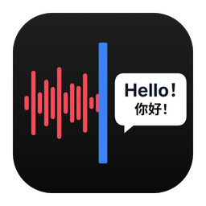
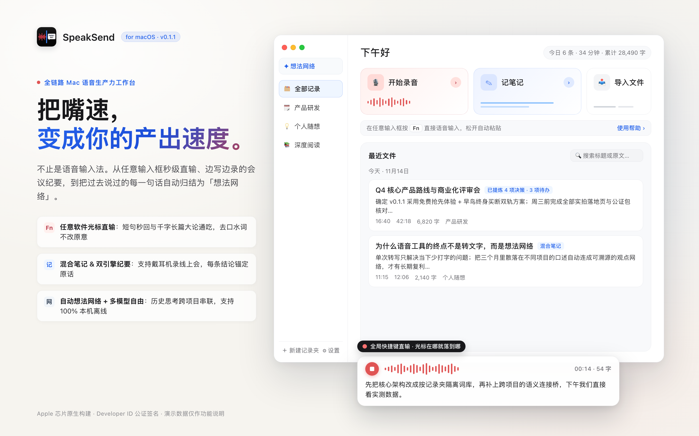
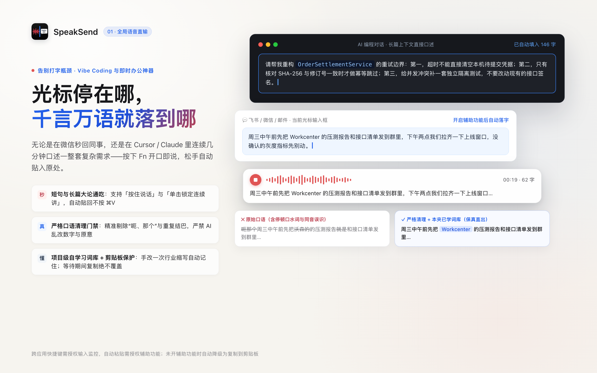
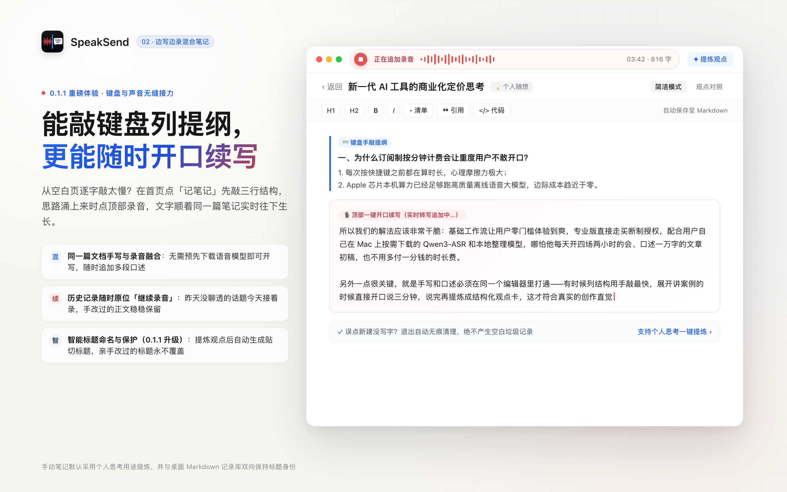
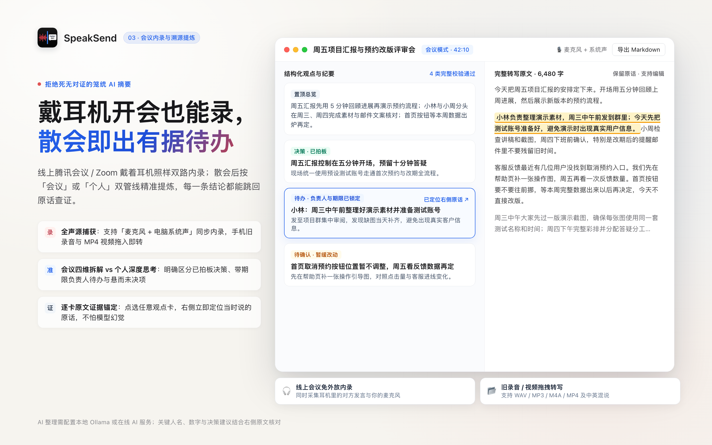
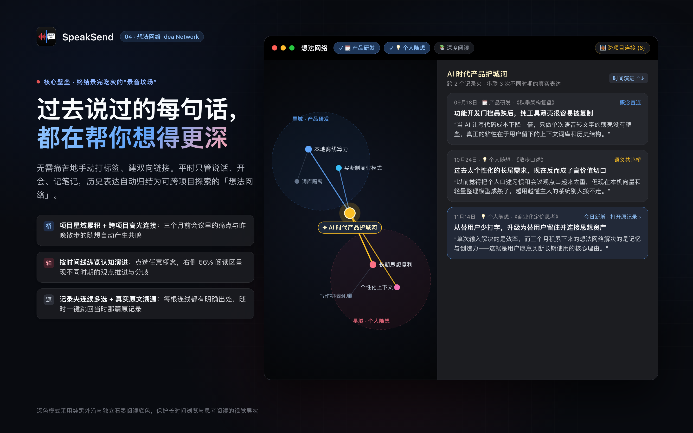
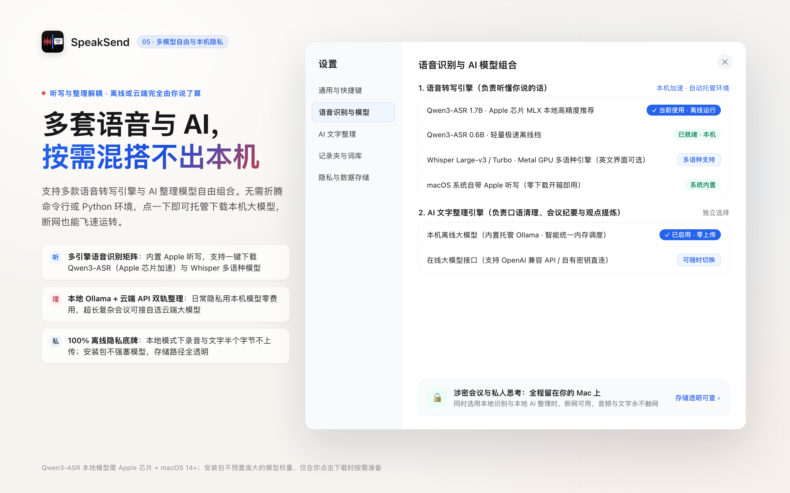
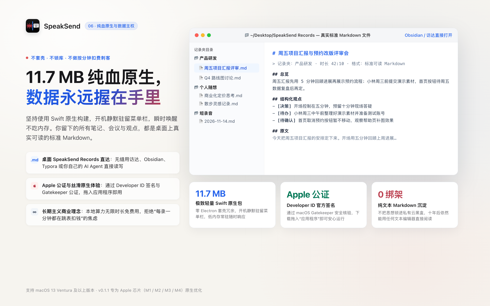

  

<h1 align="center">SpeakSend for macOS</h1>

  <b>把嘴速，变成你的产出速度。</b> 
  专为 Mac 打造的全链路语音生产力工作台：任意输入框秒级直输 · 边写边录混合笔记 · 戴耳机会议内录与溯源纪要 · 自动生长的想法网络

  <a href="https://github.com/KunZhang1997/SpeakSend/releases/download/v0.1.1/SpeakSend-0.1.1.dmg"><b>⬇️ 立即下载 SpeakSend 0.1.1（Apple 芯片 DMG · 11.7 MB）</b></a>
  &nbsp;·&nbsp;
  <a href="https://github.com/KunZhang1997/SpeakSend/releases/tag/v0.1.1">版本详情与校验</a>
  &nbsp;·&nbsp;
  <a href="#pricing">版本与早鸟方案</a>
  &nbsp;·&nbsp;
  <a href="#get-started">三步上手</a>
  &nbsp;·&nbsp;
  <a href="README_EN.md">English</a>

  

---

## 为什么重度创作者、开发者与管理者需要 SpeakSend？

打字永远追不上脑子里的想法；线上开完两小时会，还要花一小时重听整理；一年录下上百条语音备忘，最后却躺在文件夹里成了“录音坟场”。

市面上的工具往往只切走其中一小段——要么只是个停顿就断的短句听写插件，要么是给出一堆空洞套话、漏掉关键条件还死无对证的云端会议软件。**SpeakSend 用 11.7 MB 的纯正 Swift 原生应用，把「即时表达 → 深度记录 → 长期思想复利」彻底打通：**

| 维度 | 普通语音输入 / 会议转写工具 | SpeakSend 全链路方案 |
|---|---|---|
| **即时输入** | 只能说短句；开 AI 润色容易篡改数字与原意、变成生硬“AI 腔” | **短句秒回与千字长篇口述通吃**；内置严格口语清理门禁（去口水词，严禁乱改事实），按项目自动学习你的专属黑话与缩写 |
| **会议与创作** | 戴耳机录不到对方声音；会议总结笼统，无法核查原话 | **支持麦克风 + 电脑系统声同录**；写笔记可随时开口追加续写；区分「会议四维纪要」与「个人深度思考」，**每条结论卡一键跳回原话** |
| **长期复利** | 录完 100 条躺在列表吃灰；想关联只能手动打标签、建双链 | **零手动打标，历史表达自动织成「想法网络」**：跨项目发现几个月前后的思考共鸣与认知演进 |
| **模型与隐私** | 强制上传云端、按分钟扣费跳表，笔记锁死在私有数据库 | **多套语音识别 + 本地 Ollama / 云端 API 自由混搭**；支持 **100% 离线本机运行**；所有记录实时沉淀为桌面标准 `.md` 文件 |

---

## 五大核心体验

### 1. 任意软件光标直输：从一句话秒回，到千字长篇大论

光标停在微信、飞书、邮件、文档，或是 **Cursor / Claude / ChatGPT 对话框**里——按下 `Fn`（支持「按住说话」与「单击锁定连续讲」），说完自动填入原处，连 `⌘V` 都不用按。

- **严格口语清理门禁**：精准剔除“呃、那个、就是”与重复结巴并补齐标点，一旦模型试图增删事实或改写原意即刻拦截保真。
- **项目级自学习词库 + 剪贴板零污染**：在项目里手动改过一次同音错词或英文缩写，下次开口自动认准且不同项目互不串词；等待识别期间你新复制的内容绝不会被覆盖。

  

### 2. 边写边录「混合笔记」：能敲键盘列提纲，更能随时开口往下讲

从空白页逐字敲太慢？点击首页「记笔记」直接进入纯净编辑器：先敲三行提纲，思路涌上来时点顶部「开始录音」，文字顺着同一篇文档实时往下生长。

- **历史记录原位续录**：昨天没聊透的话题，今天点「继续录音」接着往下讲，亲手修改过的正文与标题稳稳保留。
- **智能命名与无痕退出**：提炼观点后自动为默认笔记生成贴切标题，同时严格保护你的手改标题不被覆盖；误点新建未写字时，退出自动无痕清理。

  

### 3. 戴耳机内录线上会 +「会议 / 个人」双引擎溯源提炼

无论是现场会议、戴着耳机参加腾讯会议 / Zoom / 飞书线上会（开启**麦克风 + 电脑系统声音**同步采集），还是把手机里的旧录音、访谈视频（WAV / MP3 / M4A / MP4）直接拖入窗口，都能获得清晰结构：

- **会议模式**：拆解为 **置顶总览 + 决策（已拍板）+ 待办（锁定负责人与期限）+ 待确认（悬而未决）+ 讨论脉络**。
- **个人深度思考模式**：口述文章初稿、复盘、播客读书灵感时，精准提取你的**核心判断、成立前提、具体案例与待验证问题**，自动合并跨段重复口述。
- **逐卡原文证据锚定**：点击任意观点卡即可对照右侧完整转写原文，关键数字与责任归属有据可查。

  

### 4. 「想法网络」：过去说过的每一句话，都会在未来帮你想得更深

告别录完吃灰的“录音坟场”。你不需要手动打标签，也不需要手建双向链接——平时只管在不同记录夹里说话、开会、写笔记，SpeakSend 会在后台自动抽取高信息量概念与结构化观点，织成可交互的**想法网络**。

- **项目星域累积 + 跨项目语义桥**：支持记录夹连续多选范围。三个月前在《工作项目》里聊过的痛点，和昨晚散步在《个人随想》里口述的灵感，会自动架起跨项目连接桥。
- **顺着时间线看清认知演进**：点选任意概念，左侧星图聚焦，右侧 56% 阅读面板按时间轴展开不同时期的真实观点卡片，随时一键打开原记录继续深写。

  

### 5. 多套语音与 AI 引擎自由混搭 + 11.7 MB 原生数据主权

SpeakSend 将**「听懂声音的识别模型」**与**「提炼思想的 AI 模型」**完全解耦，无需折腾命令行或 Python 环境：

- **多引擎语音识别**：开箱即用 macOS 原生 Apple 听写；应用内可一键按需托管下载专为 Apple 芯片加速的 **Qwen3-ASR** 本地大模型，英文界面亦可选多语种 **Whisper** 本地引擎。
- **本地离线或云端大模型随心切**：既可一键启用本机 **Ollama** 离线大模型（配合统一内存智能调度，100% 断网零上传、零时长费），也可接入自定义 **OpenAI 兼容云端 API** 处理超长复杂会议。
- **桌面标准 Markdown 直达**：所有笔记与会议记录实时映射至 `~/Desktop/SpeakSend Records` 标准 `.md` 文件，直接用访达、Obsidian 或你自己的 AI 工具自由读写，绝不锁死在私有云黑盒里。

  

  

---

## 💎 版本方案：拒绝按分钟扣费的“转写刺客”

我们相信，借助 Apple 芯片强大的本地算力，开口说话与思考沉淀应该像呼吸一样没有计费焦虑：

| 方案 | 当前状态 | 核心权益 |
|---|---|---|
| **抢先体验版（v0.1.1 Early Access）** | **当前免费开放下载** | 完整体验全局 `Fn` 语音输入、混合记笔记、长录音与音视频导入、想法网络，以及本地语音/AI 大模型免费按需下载 |
| **SpeakSend Pro 终身买断版** | **早鸟计划筹备中** | 一次买断，拒绝订阅制按分钟跳表收费。永久解锁 Mac 端完整专业工作流、本机无限时长转写提炼、后续 1.x 功能迭代及未来跨端生态能力 |
| **团队 / 高隐私离线部署** | 欢迎联系洽询 | 面向律所、咨询、研发与教研团队的纯内网/全本机离线语音纪要工作流支持（可通过 [Issues](https://github.com/KunZhang1997/SpeakSend/issues) 联系） |

---

## 🚀 三步极速上手与系统要求

1. **下载拖入安装**：下载 **[SpeakSend-0.1.1.dmg](https://github.com/KunZhang1997/SpeakSend/releases/download/v0.1.1/SpeakSend-0.1.1.dmg)**，打开后将 `SpeakSend` 拖入「应用程序」（老版本用户直接覆盖即可，个人记录、词库与已下载模型完整保留）。
2. **按需开启权限**：首次启动允许**麦克风**与**语音识别**；如需在其他软件中按快捷键并自动贴入光标处，按引导开启**输入监控**与**辅助功能**（未开启辅助功能时自动降级为复制到剪贴板）。
3. **按下 `Fn`，开口即成稿**：在任意输入框按 `Fn` 直接说话；需要深度创作、开长会或浏览知识星图时，打开主窗口使用「开始录音」「记笔记」「导入文件」或「想法网络」。

| 环境与发行信息 | 说明 |
|---|---|
| **当前推荐版本** | **[v0.1.1 抢先体验版](https://github.com/KunZhang1997/SpeakSend/releases/tag/v0.1.1)**（11.7 MB · Apple 官方 Developer ID 签名与公证） |
| **适用芯片与系统** | `v0.1.1` 适用于 **Apple 芯片 Mac（M1 / M2 / M3 / M4）**，需 **macOS 13 Ventura+**；启用 Qwen3-ASR 本地模型需 **macOS 14 Sonoma+**（Intel Mac 用户可前往 [历史 Releases](https://github.com/KunZhang1997/SpeakSend/releases) 获取通用架构旧版） |
| **按需模型机制** | 安装包不捆绑数 GB 的模型权重；仅当你主动点击对应模型「下载」时才在本机准备 |
| **联网与隐私边界** | 同时选用本地识别模型与本地 AI 整理模型时，**100% 在本机离线完成**；使用 Apple 听写时是否联网由 macOS 决定；主动配置在线 AI 接口时，仅整理阶段将文本发往你指定的服务 |

---

## ❓ 常见问题

<b>现在下载收费吗？本地模型要钱吗？</b>

 当前 <code>v0.1.1</code> 抢先体验版完全免费下载使用，应用内无任何内购弹窗；本地语音模型（Qwen3-ASR / Whisper）与本地 AI 模型（Ollama）均免费按需下载。仅当你自行配置第三方在线大模型 API 时，由对应 API 服务商按其规则计费。

<b>可以完全断网离线使用吗？我的录音会不会被上传？</b>

 可以。下载一次本地识别模型与本地 AI 整理模型后，拔掉网线也能完成语音输入、会议转写与观点提炼，音频与文字半个字节都不会离开你的 Mac。设置中的「隐私与诊断」页面完整列出了所有本机存储目录与清理方式。

<b>从旧版本升级到 0.1.1 需要先卸载吗？</b>

 不需要，也请不要删除个人数据目录。<code>v0.1.1</code> 为公开预发布（Early Access），不通过旧版应用内自动更新推送；请直接下载最新 DMG 并拖入「应用程序」替换原应用，你的所有历史记录、记录夹、已学词库和已下载模型都会原样保留。

<b>支持哪些识别语言和界面语言？快捷键能自定义吗？</b>

 识别支持简体中文、繁体中文、English 及自动判断，导入音视频文件时支持专门的「中英混说」选项；应用界面支持简体中文、繁體中文与 English。默认全局快捷键为 <code>Fn</code>，可在「设置 → 通用」中随时改为任意习惯的组合键，并切换「按住说话」或「单击切换」。

---

## 📄 许可证与反馈

SpeakSend 当前开放免费抢先体验。本仓库用于发布官方公证安装包、产品介绍与用户反馈，产品源代码保持私有；**未经作者书面授权，不得修改、二次分发或用于商业转售**。欢迎在 [Issues](https://github.com/KunZhang1997/SpeakSend/issues) 提交使用反馈、功能建议或商业合作咨询。完整条款见 [LICENSE](LICENSE)，第三方组件说明见 [NOTICE](NOTICE)。

页面展示界面中的会议与笔记内容均为演示数据 · Made natively for Mac by <a href="https://github.com/KunZhang1997">KunZhang1997</a>

