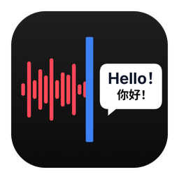
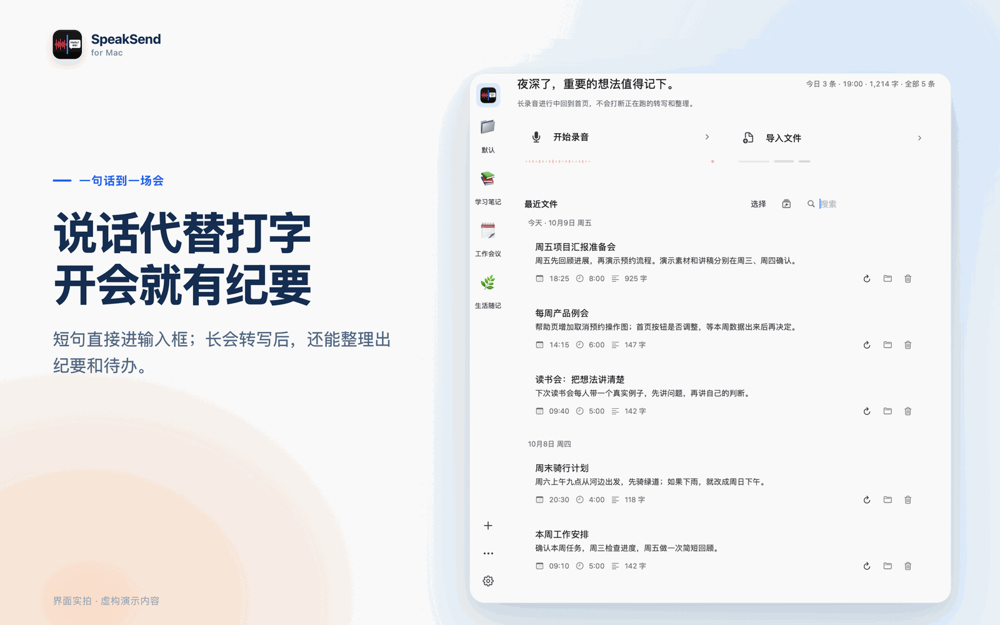
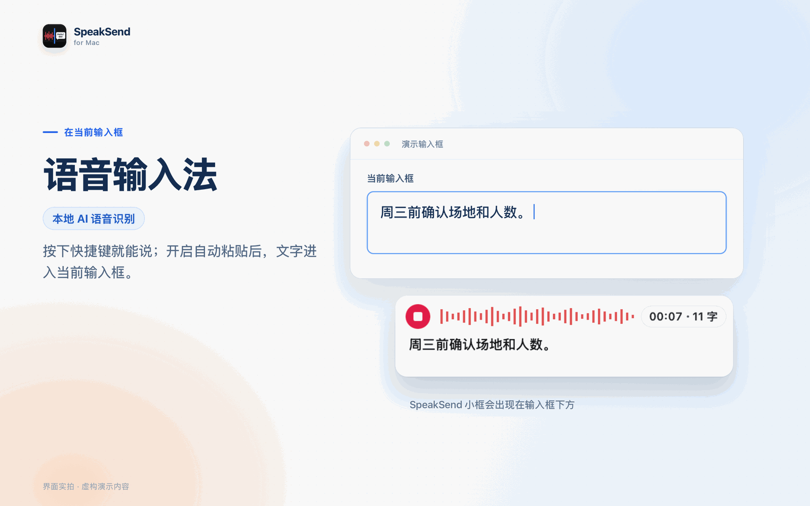
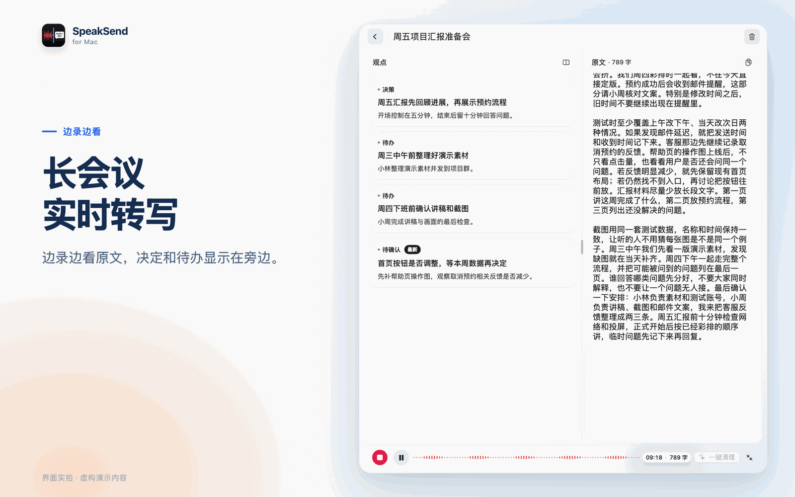
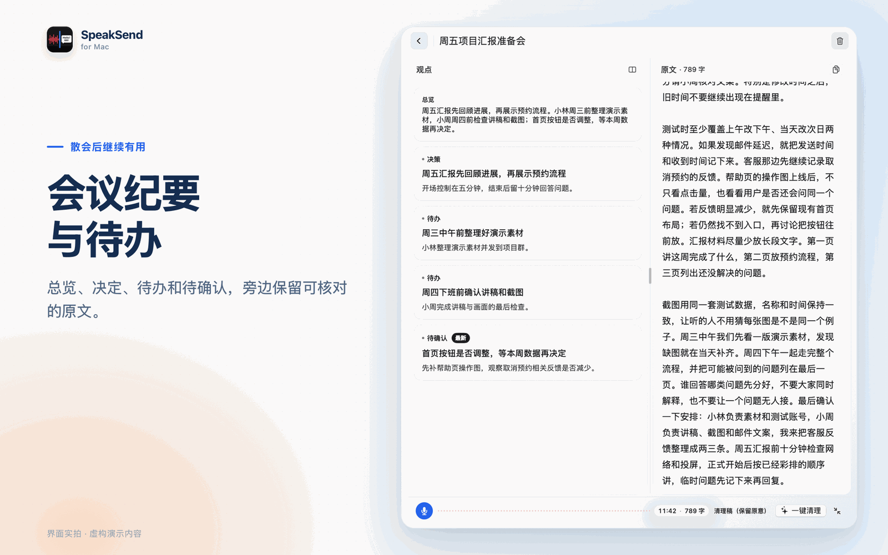
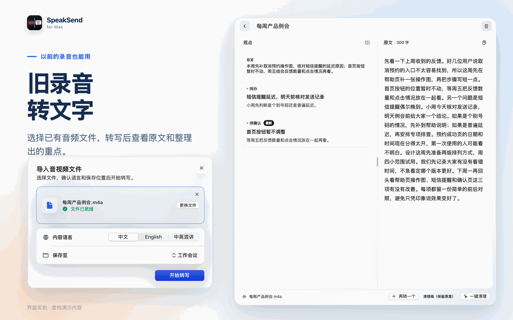
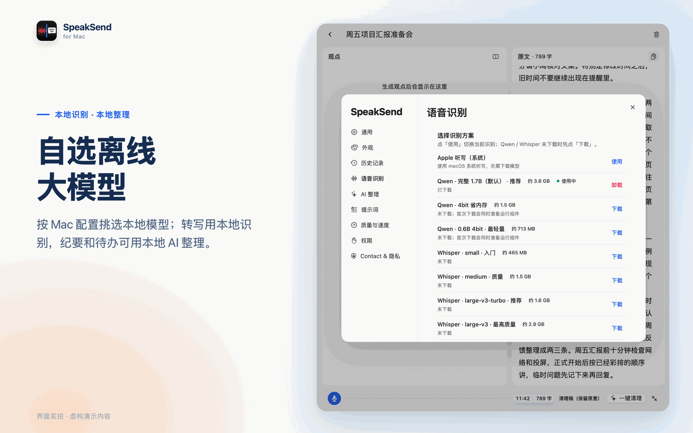

  

<h1 align="center">SpeakSend</h1>

中文 | <a href="README_EN.md">English</a>

**SpeakSend 是一款面向 macOS 的语音输入与录音转文字工具。** 用快捷键把口述输入当前应用，也可以录制长内容、导入音视频文件，再按需用 AI 整理文字。

**[下载 Mac 公开试用版（DMG）](https://github.com/KunZhang1997/SpeakSend/releases/latest)** · [安装与第一次使用](#get-started) · [常见问题](#faq) · [反馈问题](https://github.com/KunZhang1997/SpeakSend/issues)

| 使用前先看 | 说明 |
|---|---|
| 系统要求 | **macOS 13 Ventura 或更高版本** |
| Mac 芯片 | 支持 **Apple 芯片和 Intel Mac**；不同模型的要求不同 |
| Qwen3-ASR 本地识别 | 需要 **Apple 芯片 + macOS 14 或更高版本** |
| 当前状态 | **0.0.1，免费公开试用，尚未正式发布** |
| 开发者账号 | [KunZhang1997](https://github.com/KunZhang1997) |
| 下载入口 | [GitHub Releases：下载 DMG 安装包](https://github.com/KunZhang1997/SpeakSend/releases/latest)；已知问题与更新说明也在此页 |

本地模型不随安装包捆绑，只有主动点击下载时才准备。模型和所需运行组件准备好后，选择本地识别与本地 AI 整理，可以离线处理相应任务；使用 Apple 听写时，是否联网由 macOS 决定。

---

脑子里的想法比手快，打字却总是跟不上：回一条消息要敲半天，写邮件、写文档字斟句酌，开完一场会还得花一小时整理纪要。

**SpeakSend 让你先把事情说清楚，再检查文字。** 在 Mac 输入框里用快捷键录音，结束并完成识别后，可将结果粘贴回原来的位置。会议、访谈和较长的口述可以放在长录音里记录，再按需整理成纪要、待办或文稿。转写原文会保留，便于回看和核对。

  

  

## ✨ 为什么选 SpeakSend

- **⚡️ 用说话输入**：把背景、想法和要求讲出来，识别后检查文字，再发送。
- **🎯 在当前应用输入**：适合微信、邮件、文档、浏览器和 AI 对话等输入场景；跨应用快捷键需要输入监控权限，自动粘贴需要辅助功能权限。
- **⌨️ 一个键就够**：默认按 `Fn` 开始说话，可以按住说话，也可以按一下开始、再按一下结束。快捷键随时可以改。
- **🕐 记录较长内容**：会议、访谈和个人口述可以边录边转写，保存在历史记录中。
- **📋 按需用 AI 整理**：配置可用的 AI 整理模型后，将录音文字整理成决定、待办和讨论要点，并回到转写原文核对。
- **📂 旧录音也能转**：拖进已有的音视频文件（WAV、MP3、M4A、MP4 等），转写后同样可以整理。
- **🏷️ 认得你的专有名词**：热词库里加上人名、产品名、行业术语，整理和纠错时更准。
- **🔒 隐私优先**：可以选完全在本机运行的识别模型和 AI 整理模型，录音和文字都留在你的 Mac 上。

## 🎬 适合谁、怎么用

### 回消息、写邮件、写文档、和 AI 聊天

光标停在哪里，按下快捷键说话，文字就直接进入当前输入框。开启自动粘贴后连 `⌘V` 都不用按。

### 开会、访谈、讲座：边录边转写

录音过程中逐段转成文字；启用并配置可用的 AI 整理后，也可以查看提炼的要点。重要的人名、数字和决定仍需核对。

### 会后：纪要和待办一键生成

总览、决定、待办、待确认一目了然，每一条都能跳回原文核对。整理结果可以导出成 Markdown。

### 手机里的旧录音：拖进来就转成文字

选择内容语言（中文、English 或中英混说）和保存位置，转写完成后可以查看原文，也可以整理重点。

### 在意隐私：自选本地大模型

按你的 Mac 挑选识别模型，从系统自带的 Apple 听写，到本地的 Whisper、Qwen3-ASR 都可以。转写用本地识别，纪要和待办也可以交给本地 AI 整理。

<b>更多介绍图</b>

 

  
  
  

## 🚀 三步上手

1. **下载安装**：从 [最新 Releases](https://github.com/KunZhang1997/SpeakSend/releases/latest) 下载 DMG，把 SpeakSend 拖进「应用程序」。
2. **授予权限**：第一次打开时，按提示允许 **麦克风** 和 **语音识别**。如果想在其他应用里用快捷键并自动粘贴，再打开 **输入监控** 和 **辅助功能**。
3. **按下 `Fn`，开口说**：在任意输入框里说完，文字就出现了。想录长会议，就在首页点「开始录音」或「导入文件」。

## 🔒 你的声音，只属于你

- **可以全程本机处理**：选用本地识别模型（Whisper / Qwen3-ASR）和本地 AI（Ollama）后，录音和文字都不会离开你的 Mac。
- **不强塞任何东西**：安装包不捆绑模型。只有当你主动点击「下载」时，才会下载对应的模型。
- **联网方式取决于你的选择**：Apple 听写是否联网由 macOS 决定；主动配置在线 AI 服务后，整理文字会发送给所选服务。选择本地模型时，相应识别和整理任务在本机运行。
- **数据看得见**：设置里的隐私页面列出了 SpeakSend 在本机保存的所有内容，以及每一项怎么清理。

## ❓ 常见问题

<b>收费吗？</b>

 SpeakSend 目前处于测试阶段，应用内没有任何付费或内购。本地模型都是免费下载的。只有在你选择接入在线 AI 接口时，才可能由那个服务按它自己的规则收费。

<b>需要联网吗？</b>

 平时使用的是 macOS 自带的 Apple 听写，是否联网由系统决定。如果想完全离线，下载一次本地识别模型（Whisper / Qwen3-ASR）和本地 AI 模型就可以了。之后转写和整理都在本机完成。

<b>我的录音会被上传吗？</b>

 使用本地识别和本地 AI 整理时，相应处理在你的 Mac 上完成。使用 Apple 听写时，是否联网由 macOS 决定；主动配置在线 AI 服务后，整理文字会发送给该服务。本机保存内容及清理方式可在设置的隐私页面查看。

<b>支持哪些 macOS 和语言？</b>

 需要 macOS 13 Ventura 及以上。Qwen3-ASR 本地模型需要 Apple 芯片和 macOS 14 及以上。识别语言支持简体中文、繁体中文、英文，也可以自动判断。导入文件时可以选择「中英混说」。界面有简体中文、繁體中文和 English 三种语言。

<b>快捷键能改吗？</b>

 可以。默认是 <code>Fn</code>，在「设置 → 通用」里可以换成你习惯的组合键，并选择「按住说话」或「单击切换」。

---

## 📄 许可证

SpeakSend 可以免费使用。本仓库仅公开安装包、介绍和图片，源代码不公开。**未经作者书面同意，不得修改、再发布或商用**。欢迎在 [Issues](https://github.com/KunZhang1997/SpeakSend/issues) 里提问题和建议，本仓库不接受外部代码提交。完整条款见 [LICENSE](LICENSE)，第三方组件说明见 [NOTICE](NOTICE)。

截图与介绍图中的内容均为演示数据。

