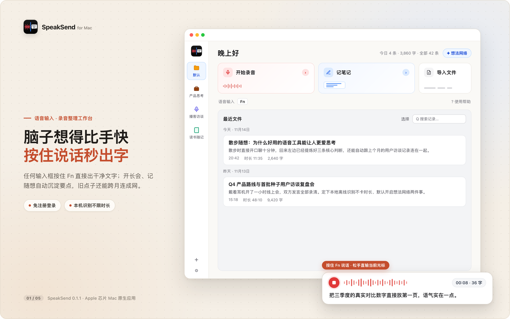
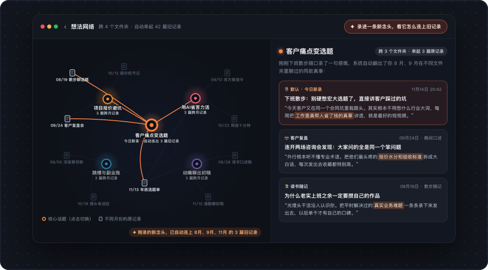

<strong>中文</strong> · <a href="README_EN.md">English</a>

# SpeakSend

**Mac 上的语音输入与录音整理工作台。**  
短句按住 `Fn` 直输当前输入框；长会与随想留成结构化笔记，几个月前的旧点子还会自动连成网。

  <a href="https://github.com/KunZhang1997/SpeakSend/releases/download/v0.1.5/SpeakSend-0.1.5.dmg"><strong>⬇️ 免费下载 SpeakSend 0.1.5 (.dmg)</strong></a>
  &nbsp;·&nbsp; 抢先体验版 · 免注册登录 · 本机识别不限时长

---

### 1. 全局语音输入：指哪说哪，自动剃掉口水词

在 AI 对话框、飞书、微信、邮件或任意编辑器里按住 `Fn` 开口即说，松手直接填入当前光标位置，自动去掉“呃、那个”等口头禅，保留你的真实语气与专有名词。

### 2. 长录音与混合笔记：边写边录，结论直查原话

既能先敲几行提纲再随时点麦克风接着口述，也支持戴耳机录制线上会议双方声音。左侧自动整理总览、已拍板与待办，点击任意结论即可定位右侧当时那句原话。

### 3. 想法网络：告别录音坟场，旧记录自动成网

无需手动打标签或建双链，日常散步随记与会议复盘会在后台自动串联同类话题，支持按记录夹多选查看范围，随时翻出几个月前的每句原话。

### 4. 本机离线与开放存储：不按分钟扣费，直接存成 `.md`

可在设置中一键下载免费的 `Qwen3-ASR`、`Whisper` 本地语音模型并搭配本地 `Ollama` 整理引擎，断网可用、私密内容不出本机；每条记录实时存为本地 Markdown 文档，访达或 Obsidian 直接打开。

---

> “散步和开会时脑子里念头冒得太快，手敲根本追不上；市面上的工具要么按分钟跳表算钱，要么逼我把私密谈话传上云端。干脆自己动手，做出了这件每天写稿、复盘离不了手的主力工具。”  
> — **Kun97（坤九七）** · 产品顾问，SpeakSend 开发者

---

### 下载与安装

- **安装包下载**：[**SpeakSend-0.1.5.dmg**](https://github.com/KunZhang1997/SpeakSend/releases/download/v0.1.5/SpeakSend-0.1.5.dmg)（当前免费开放完整功能）
- **系统要求**：Apple 芯片 Mac（M1 / M2 / M3 / M4），macOS 13.0+（线上会议双端内录需 macOS 14.2+，Qwen3-ASR 本地模型需 macOS 14.0+）
- **安装方式**：已通过 Apple Developer ID 签名与官方公证，打开 `.dmg` 将 `SpeakSend.app` 拖入 `Applications` 即可使用
- **问题反馈**：[GitHub Issues](https://github.com/KunZhang1997/SpeakSend/issues)
