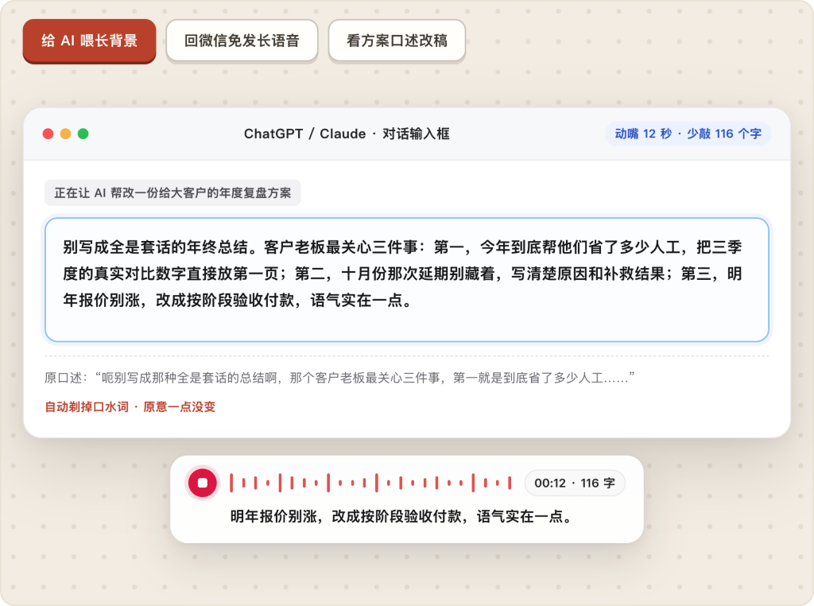

<strong>中文</strong> · <a href="README_EN.md">English</a>

# SpeakSend

**脑子想得比手快，按住说话秒出字。**

任何软件输入框按住 `Fn`，松手就出干净文字。开长会不用重听，点结论直查原话。几个月随口聊过的旧点子，还会自动连成网。

  <a href="https://github.com/KunZhang1997/SpeakSend/releases/download/v0.1.1/SpeakSend-0.1.1.dmg"><strong>⬇️ 免费下载 SpeakSend 0.1.1 (.dmg)</strong></a>
  &nbsp;·&nbsp; 抢先体验版 · 免注册登录 · 本机识别不限时长

- **指哪说哪** — 光标停在哪就说在哪。按住 `Fn` 动嘴，松手秒出字，连粘贴都不用按。
- **边写边录** — 先敲三行提纲，点麦克风接着往下聊。AI 拎出重点，句句对得上原话。
- **旧话成网** — 不用建双链，也不用打标签。前几个月随口聊过的灵感，自动串成一张网。

---

### 只剃掉口水词，绝不乱改你的原意。

跟 AI 交代五百字背景，敲键盘手都酸了，动嘴只要十几秒。回飞书、微信不用发长语音，松手直接变成清爽文字。自动删掉“呃、那个”，不改油腻 AI 腔；改过一次的人名和缩写，下次开口直接写对。

  

---

### 一小时长会不用重听，点左边结论，查右边原话。

戴着耳机开线上会也能录清双方声音，写文章卡壳随时点麦克风接着聊。左边直接拎出拍板数字与待办，拿不准的地方点一下，右边立刻跳出当时那句原话。

---

### 不用打标签、不用建双链，几个月前聊过的点子自动成网。

你只管平时散步随口记、开会顺手录，它在后台自动挑出同类话题串成线。八月散步聊过的念头，会自动连上十一月的复盘笔记，点开就能翻出当时每一句原话。

---

### 不传云端不怕泄密，跑在自己电脑上，说多久都不收时长费。

一键装好免费本地语音与整理模型，断网照样转写；每条录音和笔记实时存成桌面文件夹里的本地 `.md` 文档，访达或 Obsidian 随时直接打开。

---

### 下载与安装

- **安装包下载**：[**SpeakSend-0.1.1.dmg**](https://github.com/KunZhang1997/SpeakSend/releases/download/v0.1.1/SpeakSend-0.1.1.dmg)（当前免费开放完整功能 · 本机识别不限时长）
- **系统要求**：Apple 芯片 Mac（M1 / M2 / M3 / M4），macOS 13.0+（线上会议双端录音需 macOS 14.2+）
- **安装方式**：已通过 Apple 官方公证签名，打开 `.dmg` 将 `SpeakSend.app` 拖入 `Applications` 即可使用，无需注册登录
- **问题反馈**：[GitHub Issues](https://github.com/KunZhang1997/SpeakSend/issues)

---

SpeakSend · Kun97 作品（展示图中的会议与笔记内容均为示例数据）
