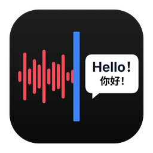
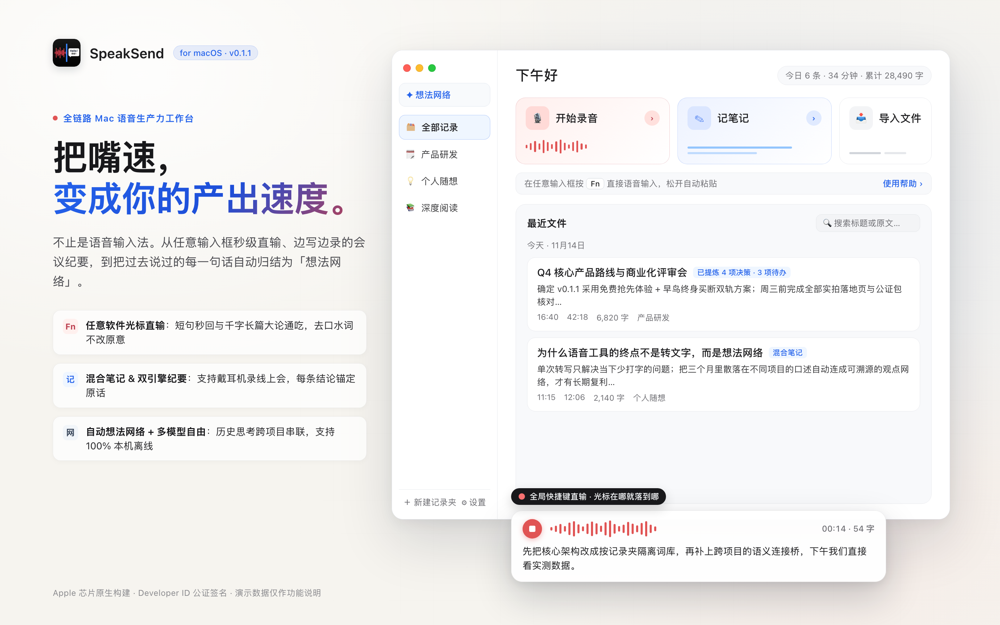
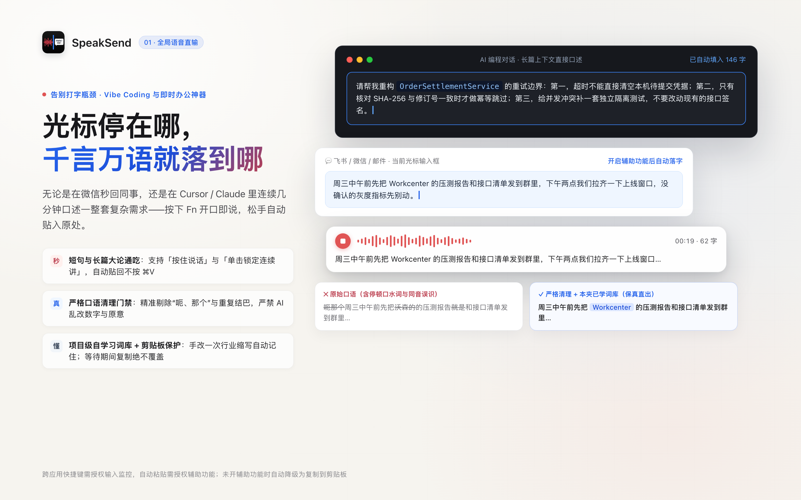
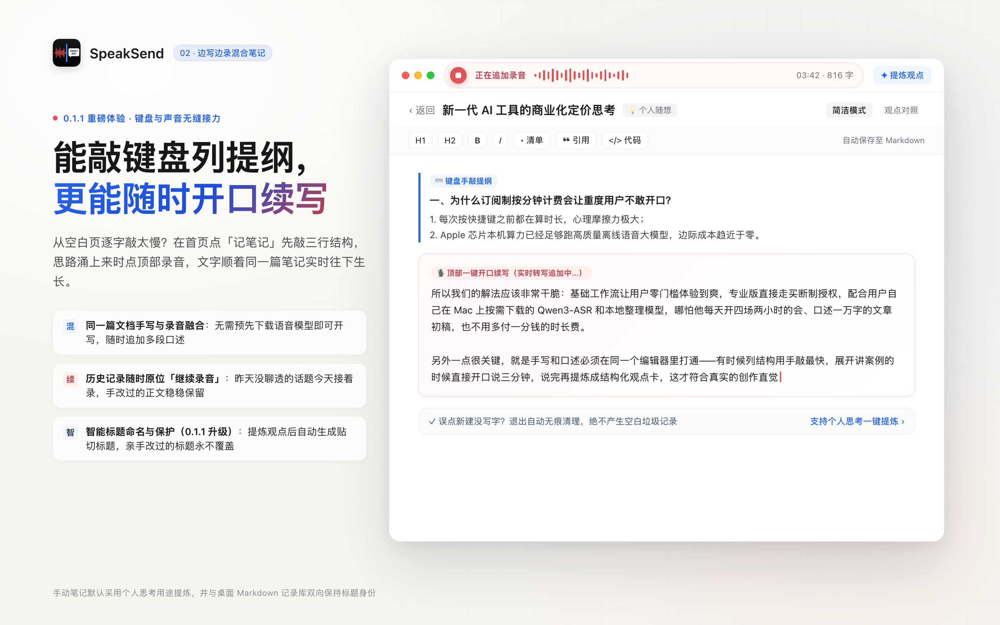
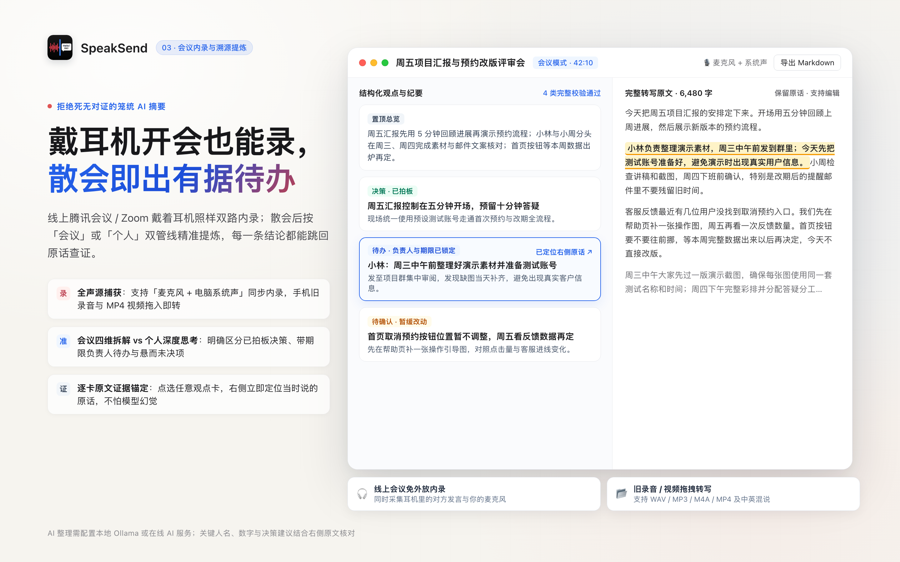
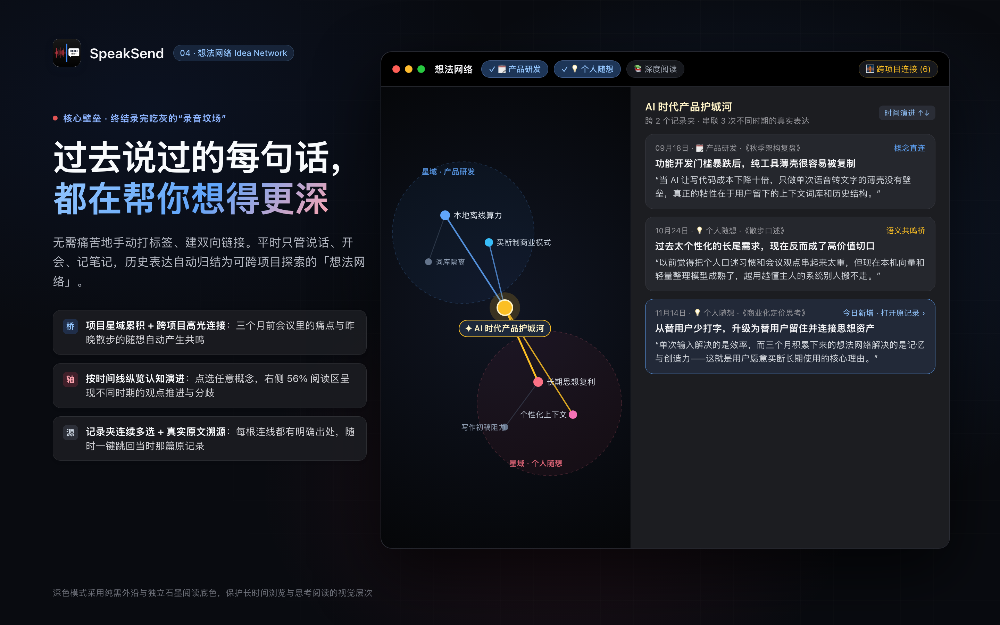
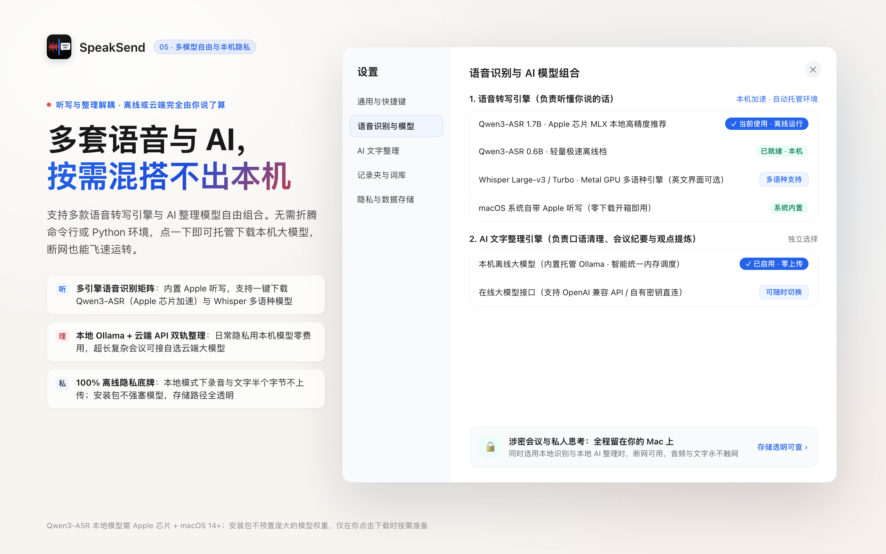
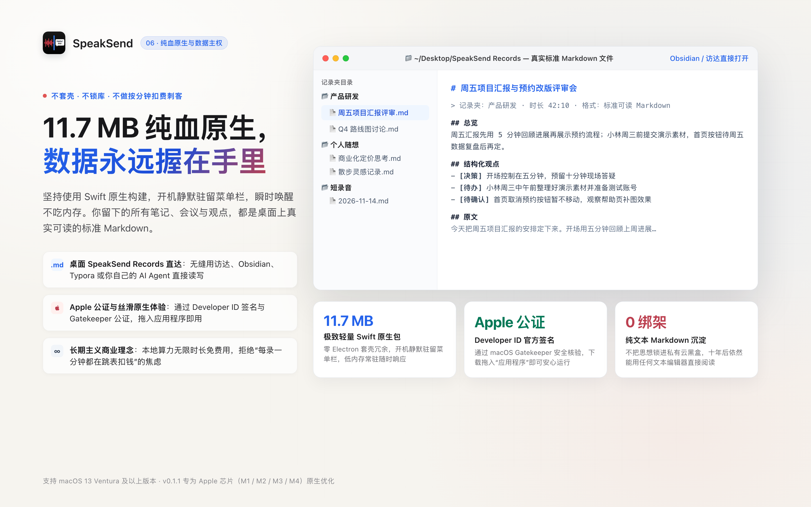

  

<h1 align="center">SpeakSend for macOS</h1>

  <b>Turn Your Speaking Speed into Output Speed.</b> 
  The native macOS voice productivity workspace: instant cursor-level dictation in any app, write-and-record hybrid notes, headphone-friendly meeting capture with source-linked insights, and an automatic Idea Network.

  <a href="https://github.com/KunZhang1997/SpeakSend/releases/download/v0.1.1/SpeakSend-0.1.1.dmg"><b>⬇️ Download SpeakSend 0.1.1 (Apple Silicon DMG · 11.7 MB)</b></a>
  &nbsp;·&nbsp;
  <a href="https://github.com/KunZhang1997/SpeakSend/releases/tag/v0.1.1">Release Notes & SHA-256</a>
  &nbsp;·&nbsp;
  <a href="#pricing">Editions & Early-Bird Plan</a>
  &nbsp;·&nbsp;
  <a href="#get-started">Quick Start</a>
  &nbsp;·&nbsp;
  <a href="README.md">中文介绍</a>

  

---

## Why Builders, Writers, and Teams Choose SpeakSend

Typing bottlenecks fast thinking. Two-hour online meetings take another hour to summarize. Worst of all, hundreds of voice memos end up buried in a "recording graveyard," never read again.

Most tools only solve a fragment—either a fragile short-sentence dictation widget or a cloud meeting bot that produces vague, unverifiable summaries while charging by the minute. **Built natively in Swift (just 11.7 MB), SpeakSend connects instant voice input, structured meeting/note capture, and long-term knowledge compounding in one cohesive workspace:**

- **⚡ Instant Voice Input Anywhere**: Press `Fn` (Hold-to-Talk or Click-to-Toggle) to dictate a quick reply in Slack/WeChat/Mail or a 500-word architectural prompt into **Cursor / Claude / ChatGPT**. Strict clean-up strips filler words without rewriting your meaning, backed by clipboard-collision protection and per-folder self-learning vocabulary.
- **✍️ Write-and-Record Hybrid Notes**: Type a 3-line outline, click **Start Recording** right inside the note to speak the rest, or resume recording on past notes anytime. Smart auto-titling names untitled notes after insight extraction while strictly preserving manual titles.
- **🎧 Headphone Meeting Capture + Source-Verified Insights**: Record **Microphone + Mac System Audio** simultaneously for Zoom/Teams calls or drag in existing audio/video (`WAV`, `MP3`, `M4A`, `MP4`). Dedicated **Meeting** (`Overview`, `Decisions`, `Action Items`, `Open Questions`) and **Personal Thinking** pipelines anchor every insight card directly to the exact source quote.
- **🕸️ Idea Network (Zero Manual Tagging)**: Stop letting great spoken thoughts collect dust. SpeakSend automatically connects concepts and insights across your project folders over time—revealing cross-project bridges and chronological evolution with one-click jumps back to original transcripts.
- **🔒 Multi-Engine Model Freedom & Plain Markdown Ownership**: Mix and match **Apple Dictation**, **Qwen3-ASR** (Apple Silicon MLX), or **Whisper** (Metal GPU) with local **Ollama** LLMs or your own **OpenAI-compatible Cloud API**. Run **100% offline on-device**, with every record saved as clean, standard `.md` files in `~/Desktop/SpeakSend Records` ready for Finder or Obsidian.

---

## Visual Tour

  

  

  

  

  

  

---

## 💎 Editions & Commercial Roadmap (No Per-Minute Metered Traps)

| Edition | Status | Highlights |
|---|---|---|
| **Early Access (`v0.1.1`)** | **Free Download Today** | Full access to global `Fn` voice input, hybrid notes, long-session workbench, file import, Idea Network, and free on-demand local ASR/LLM downloads |
| **SpeakSend Pro (Lifetime License)** | **Early-Bird Coming Soon** | One-time purchase—no per-minute transcription anxiety. Unlocks unlimited local workflows, full Idea Network capabilities, and 1.x updates |
| **Team / Offline Enterprise** | Contact via [Issues](https://github.com/KunZhang1997/SpeakSend/issues) | Dedicated air-gapped / 100% on-device deployment guidance and custom glossary workflows for legal, consulting, and R&D teams |

---

## 🚀 Get Started in 3 Steps

1. **Install**: Download **[SpeakSend-0.1.1.dmg](https://github.com/KunZhang1997/SpeakSend/releases/download/v0.1.1/SpeakSend-0.1.1.dmg)** and drag `SpeakSend` into `Applications` (existing users can drag-and-replace directly—all records, folders, and downloaded models remain intact).
2. **Grant Permissions**: Allow **Microphone** and **Speech Recognition** on first launch. Enable **Input Monitoring** (for global shortcuts across apps) and **Accessibility** (for automatic paste-back; falls back to clipboard copy if disabled).
3. **Press `Fn` & Speak**: Dictate directly into any focused text field, or open the main workspace to record meetings, write hybrid notes, import media, and explore your **Idea Network**.

- **System Requirements**: `v0.1.1` is built natively for **Apple Silicon Macs (M1 / M2 / M3 / M4)** running **macOS 13 Ventura+** (`Qwen3-ASR` requires **macOS 14 Sonoma+**; Intel Mac users may use the earlier universal release on [Releases](https://github.com/KunZhang1997/SpeakSend/releases)).
- **Signed & Notarized**: Developer ID signed and notarized by Apple (`11.7 MB`, no bundled model bloat).

---

## 📄 License & Feedback

SpeakSend is free to try during Early Access. This repository hosts official notarized installers, product documentation, and issue tracking; source code remains private. **Modification, redistribution, or commercial resale without prior written permission is prohibited.** Report bugs or share feedback via [Issues](https://github.com/KunZhang1997/SpeakSend/issues). See [LICENSE](LICENSE) and [NOTICE](NOTICE) for full terms.

All meeting transcripts and notes shown in product visuals use fictional demo content.

