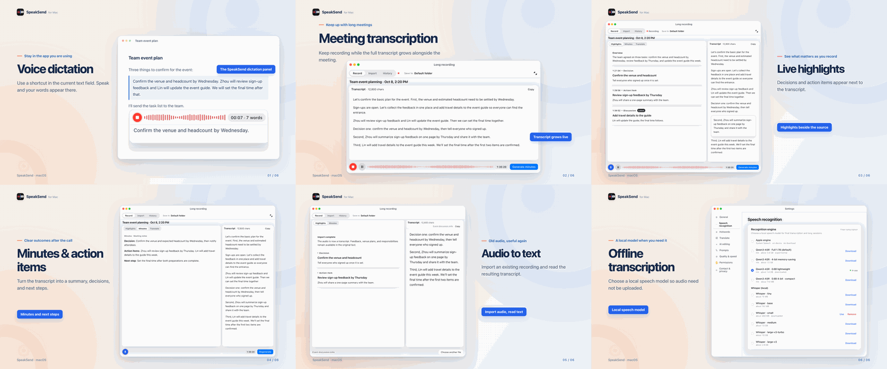
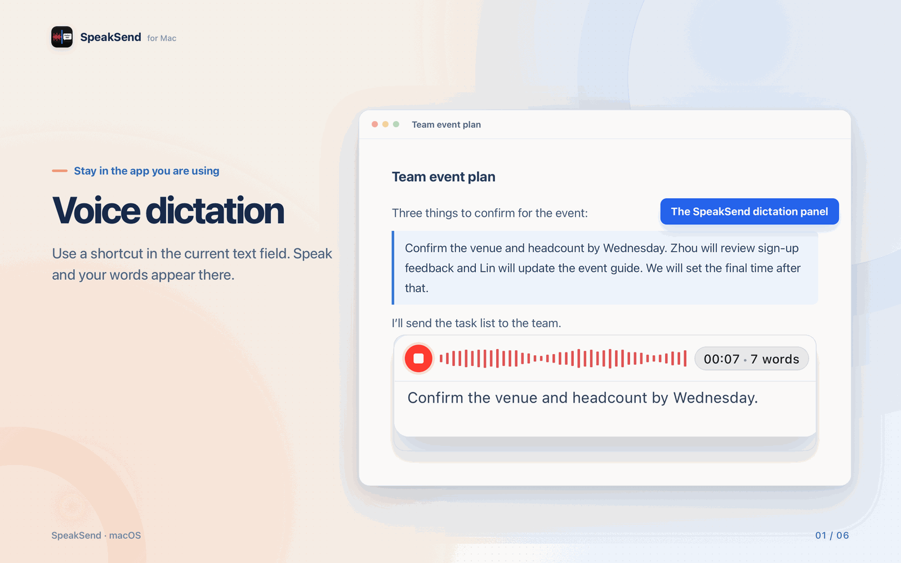
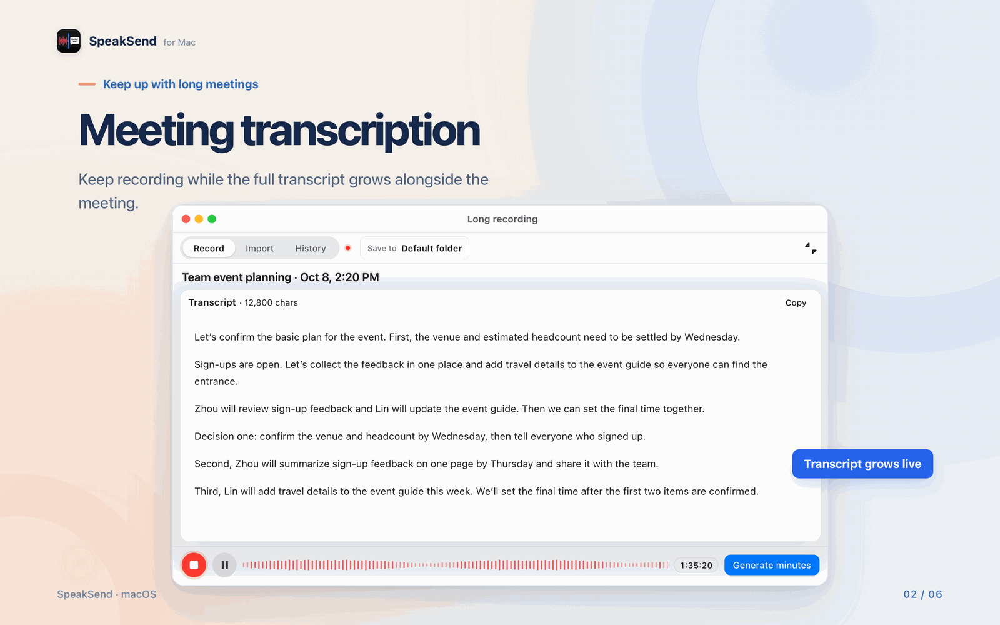
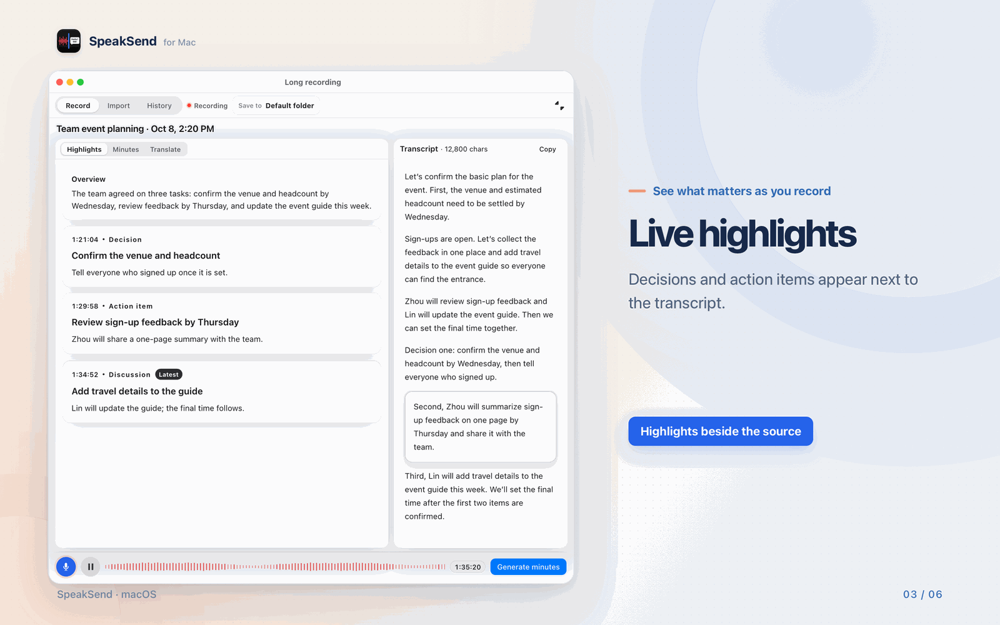
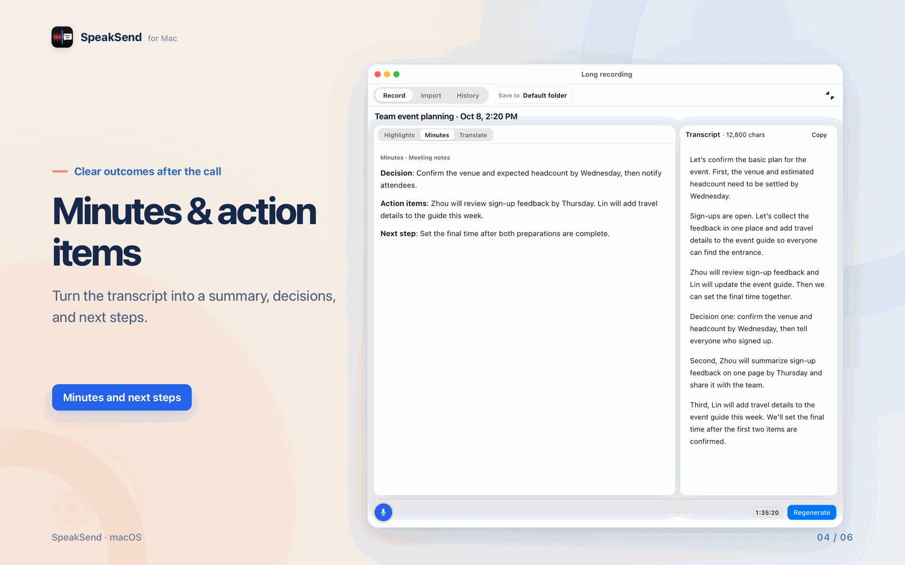
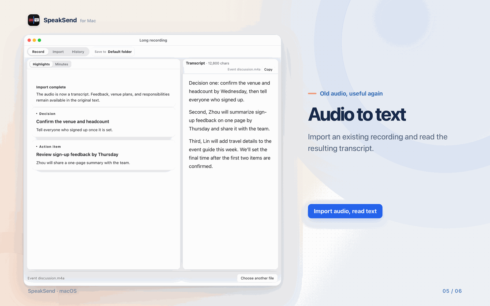
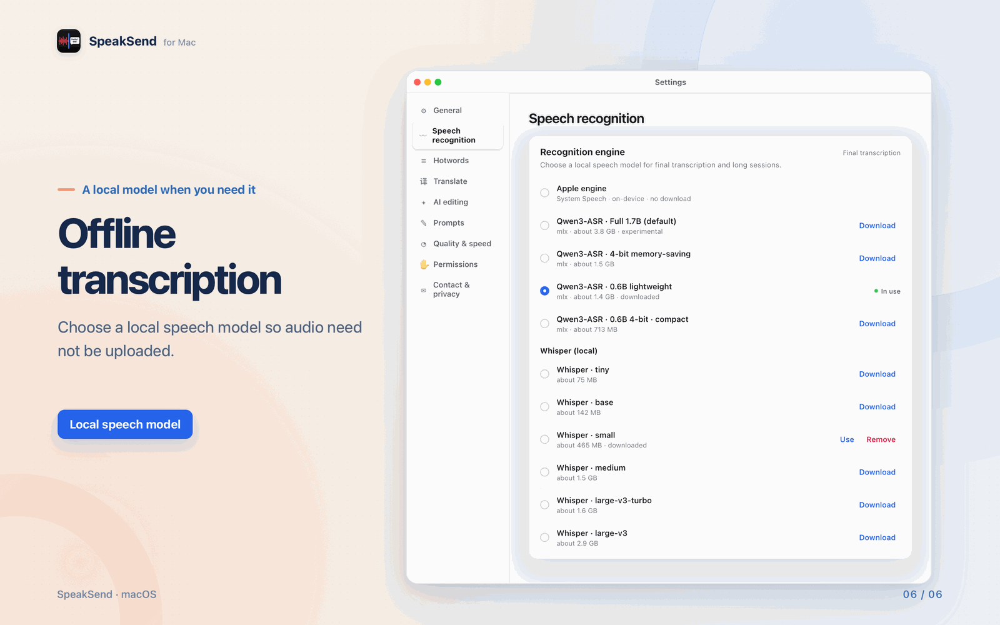

  

<h1 align="center">SpeakSend</h1>

<a href="README.md">中文</a> | English

**SpeakSend is a voice typing and audio transcription app for macOS.** Use a keyboard shortcut to dictate into the app you're working in, record longer sessions, or import audio and video files. AI text organization is optional.

**[Download the Mac public test build (DMG)](https://github.com/KunZhang1997/SpeakSend/releases/latest)** · [Install and get started](#get-started) · [FAQ](#faq) · [Report an issue](https://github.com/KunZhang1997/SpeakSend/issues)

| Before you install | Details |
|---|---|
| System requirement | **macOS 13 Ventura or later** |
| Mac hardware | **Apple silicon and Intel Macs**; individual models have their own requirements |
| Local Qwen3-ASR recognition | Requires **Apple silicon and macOS 14 or later** |
| Current status | **0.0.1, free public testing; not yet officially released** |
| Developer account | [KunZhang1997](https://github.com/KunZhang1997) |
| Download | [GitHub Releases: download the DMG installer](https://github.com/KunZhang1997/SpeakSend/releases/latest); known issues and update notes are on that page |

Models are not bundled with the installer. Downloads start only when you choose them. Once the local models and required runtime components are ready, select local speech recognition and local AI to process those tasks offline. When you use Apple Dictation, macOS determines whether it connects to the internet.

---

Your thoughts move faster than your fingers. Replying to a message takes longer than it should, emails and docs turn into a slog, and after an hour-long meeting you spend another hour writing it up.

**SpeakSend lets you talk through an idea, then check the text.** Start recording with a shortcut in a Mac text field. Once recognition finishes, the result can be pasted back where you started. Use longer recordings for meetings, interviews and voice notes, then organize the text into notes or action items when needed. The transcript is retained so you can review it.

  

## ✨ Why SpeakSend

- **⚡️ Speak instead of typing**: explain the context, your ideas and what you need, then review the recognized text before sending it.
- **🎯 Dictate where you work**: use it in messages, email, documents, browser fields and AI chats. Cross-app shortcuts require Input Monitoring; automatic pasting requires Accessibility permission.
- **⌨️ One key does it**: press `Fn` to start. Hold to talk, or tap to start and tap again to stop. You can change the shortcut anytime.
- **🕐 Record longer sessions**: transcribe meetings, interviews and personal voice notes as you record, and keep them in your history.
- **📋 Organize text with AI**: configure an available AI model to turn the transcript into decisions, action items and discussion points, then check them against the transcript.
- **📂 Old recordings, too**: drop in existing audio or video (WAV, MP3, M4A, MP4 and more), then transcribe and organize it the same way.
- **🏷️ Knows your jargon**: add names, product terms and industry vocabulary to the hotword library for sharper cleanup and corrections.
- **🔒 Privacy first**: choose speech and AI models that run entirely on your Mac, so your audio and text stay with you.

## 🎬 Made for how you work

### Messages, email, docs and AI chats

Put your cursor anywhere, press the shortcut and speak. The text goes straight into the field you're in. With auto-paste on, you don't even need `⌘V`.

### Meetings, interviews and lectures, transcribed live

Text appears as recorded segments are transcribed. With an available AI model configured and text organization enabled, you can also view extracted highlights. Check important names, numbers and decisions.

### After the call: minutes and to-dos in one click

You get a summary, the decisions and the next steps, and each one links back to the transcript so you can check it. Export the results as Markdown.

### That recording on your phone: drop it in, get text

Pick the spoken language (Chinese, English or mixed) and where to save it. When it's done, read the transcript or turn it into highlights.

### Privacy-minded: pick your own local model

Choose the recognizer that fits your Mac, from built-in Apple Dictation to local Whisper or Qwen3-ASR models. Transcription runs locally, and a local AI can write the minutes and to-dos too.

## 🚀 Get started in 3 steps

1. **Install**: download the DMG from the [latest release](https://github.com/KunZhang1997/SpeakSend/releases/latest) and drag SpeakSend into Applications.
2. **Grant permissions**: on first launch, allow **Microphone** and **Speech Recognition**. To use the shortcut in other apps and auto-paste, also enable **Input Monitoring** and **Accessibility**.
3. **Press `Fn` and talk**: speak into any text field and your words appear. For a long meeting, click "Start Recording" or "Import File" on the home screen.

## 🔒 Your voice stays yours

- **Fully on-device if you want**: with local speech models (Whisper / Qwen3-ASR) and a local AI (Ollama), your audio and text never leave your Mac.
- **Nothing forced on you**: the installer ships with no models. A model is only downloaded when you click "Download".
- **Connectivity depends on your choices**: macOS determines whether Apple Dictation connects online. If you configure an online AI service, text is sent to that service for organization. With local models selected, those recognition and AI tasks run on your Mac.
- **See what's stored**: the privacy page in Settings lists everything SpeakSend keeps on your Mac and how to clear each item.

## ❓ FAQ

<b>Is it free?</b>

 SpeakSend is currently in testing, and there are no payments or in-app purchases in the app. Local models are free to download. If you connect an online AI service, that service may charge you under its own terms.

<b>Does it need an internet connection?</b>

 By default it uses the Apple Dictation built into macOS, and macOS decides whether that goes online. To go fully offline, download a local speech model (Whisper / Qwen3-ASR) and a local AI model once. After that, transcription and cleanup happen entirely on your Mac.

<b>Is my audio uploaded?</b>

 With local speech recognition and local AI selected, those tasks run on your Mac. When you use Apple Dictation, macOS determines whether it connects online. If you configure an online AI service, text is sent to that service for organization. See the privacy page in Settings for what is stored locally and how to clear it.

<b>Which macOS versions and languages are supported?</b>

 macOS 13 Ventura or later. The local Qwen3-ASR models need Apple silicon and macOS 14 or later. Speech recognition supports Simplified Chinese, Traditional Chinese and English, with automatic detection, and imported files can be set to mixed Chinese/English. The interface is available in Simplified Chinese, Traditional Chinese and English.

<b>Can I change the shortcut?</b>

 Yes. The default is <code>Fn</code>. In Settings → General you can switch to any key combo you like, and choose between "Hold to talk" and "Tap to toggle".

---

## 📄 License

SpeakSend is free to use. This repository publishes only installers, product information, and images; the source code is private. **You may not modify, redistribute, or use it commercially without the author's written permission**. Bug reports and suggestions are welcome in [Issues](https://github.com/KunZhang1997/SpeakSend/issues); external code contributions are not accepted. See [LICENSE](LICENSE) for the full terms and [NOTICE](NOTICE) for third-party components.

All content shown in screenshots is demo data.

