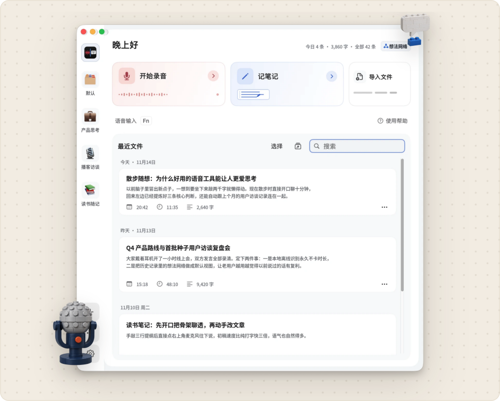
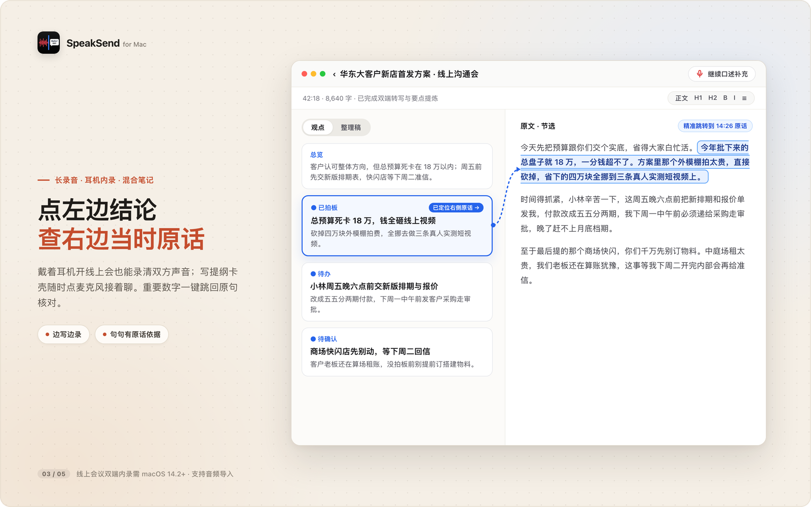
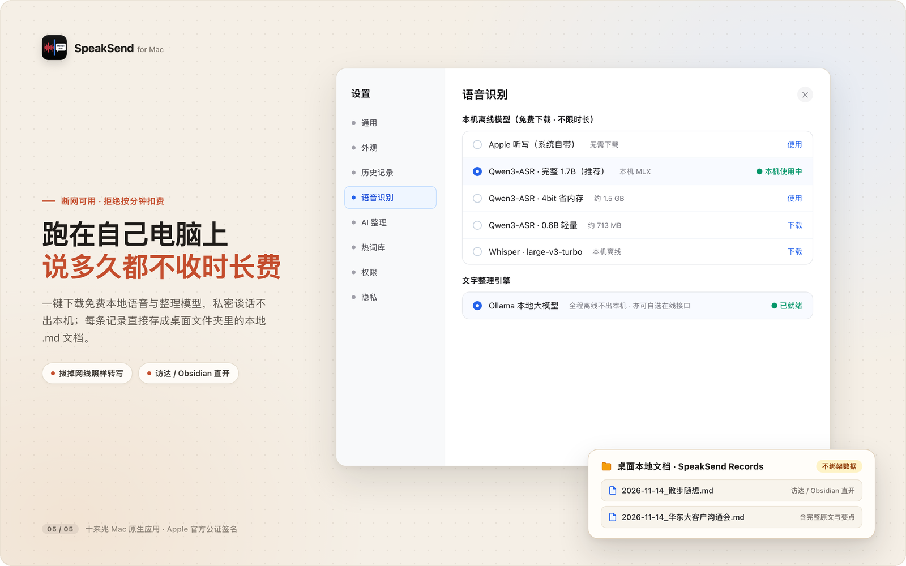

<a href="README.md">中文</a> · <strong>English</strong>

# SpeakSend

**Think faster than you type — hold to speak, release for clean text.**

Hold `Fn` in any macOS text field and release to insert clean text right at your cursor. Review hour-long meetings without re-listening — click any takeaway on the left to jump straight to the exact spoken quote on the right. Ideas mentioned months apart automatically connect into a network.

  <a href="https://github.com/KunZhang1997/SpeakSend/releases/download/v0.1.1/SpeakSend-0.1.1.dmg"><strong>⬇️ Free Download · SpeakSend 0.1.1 (.dmg)</strong></a>
  &nbsp;·&nbsp; Early Access · No Sign-up · Unlimited On-Device Transcription

- **Speak Anywhere** — Where your cursor is, your words go. Hold `Fn` to talk, release to insert — no copy-paste needed.
- **Write & Record Together** — Jot down a three-line outline, click the mic to keep talking, and verify every AI takeaway against the verbatim transcript.
- **Ideas Connect Automatically** — No manual tags or backlinks. Passing thoughts from months ago automatically link across folders.

---

### Trims filler words, never rewrites your voice.

Give AI 500 words of context in seconds instead of typing until your hands ache, or reply in chat with clean text instead of long voice messages. Automatically strips "uh" and "um" without turning your tone into generic AI prose — and remembers names and terms once you correct them.

  

---

### Skip re-listening to hour-long meetings — click a takeaway, check the exact quote.

Captures both sides clearly even when wearing headphones in online meetings, and lets you switch seamlessly between typing and speaking. Key numbers and action items are pulled out on the left; click any item to highlight the exact original sentence on the right.

---

### No tags, no manual backlinks — months-old thoughts connect on their own.

Record casual walks and meeting notes as usual while SpeakSend quietly threads related topics together in the background. A passing thought from August links right back to a November review note, with every original quote one click away.

---

### Works offline, stays on your Mac, and never bills by the minute.

Run local speech and structuring models right on your Mac so sensitive conversations never leave your machine, or connect optional online models when needed. Every note and transcript is saved directly as plain `.md` files on disk — ready for Finder or Obsidian anytime.

---

### Download & Install

- **Installer**: [**SpeakSend-0.1.1.dmg**](https://github.com/KunZhang1997/SpeakSend/releases/download/v0.1.1/SpeakSend-0.1.1.dmg) (Early Access · Full features unlocked for free · Unlimited local transcription)
- **Requirements**: Apple silicon Mac (M1 / M2 / M3 / M4), macOS 13.0+ (macOS 14.2+ required for dual-channel online meeting audio)
- **Install**: Apple Developer ID signed & notarized. Open the `.dmg`, drag `SpeakSend.app` into `Applications`, and press `Fn` to start speaking — no account required.
- **Feedback**: [GitHub Issues](https://github.com/KunZhang1997/SpeakSend/issues)

---

SpeakSend · Made by Kun97 (All notes and meeting excerpts in screenshots are fictional examples)
